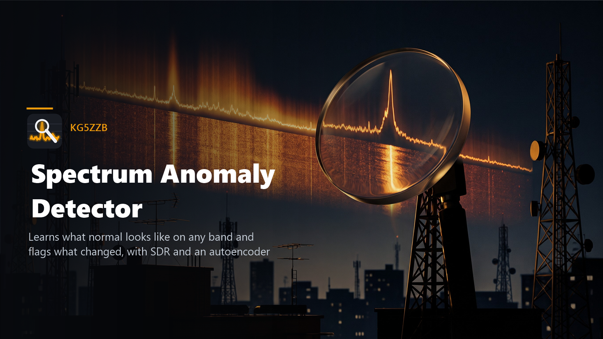
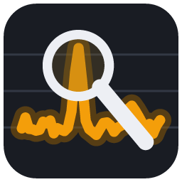
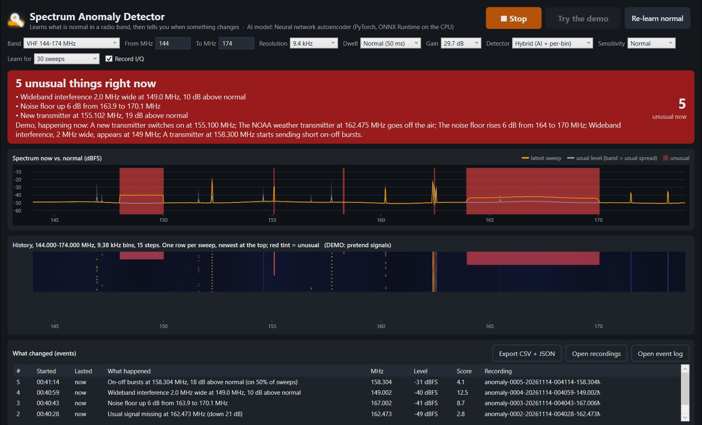

# KG5ZZB - Spectrum Anomaly Detector

**Spectrum monitoring and interference hunting for Windows with a low-cost RTL-SDR: the app learns what is normal in a radio band, and a neural-network autoencoder flags what changes, in plain words, with the I/Q saved as SigMF.**

The app sweeps any range an RTL-SDR can tune (about 24 MHz to 1.7 GHz), builds a power spectral density (PSD) history, and learns a **baseline** of every frequency bin: its usual level and spread, overall and per hour of the day. A small **PyTorch-trained autoencoder**, running on the CPU with **ONNX Runtime**, scores every 64-bin x 4-sweep patch of the spectrum against that baseline. Unusual regions become **events** such as *"New transmitter at 155.100 MHz, 18 dB above normal"*, *"Usual signal missing at 162.475 MHz"* or *"Noise floor up 6 dB from 164.0 to 170.0 MHz"*, logged as JSON Lines and CSV, with the raw I/Q around each one recorded in the open **SigMF** format.

It is **receive-only**: it never transmits.

> **Status: v0.1.0.** Sweep engine with configurable range and resolution, PSD stitching, time-of-day baseline, conditional autoencoder (ONNX) and per-bin threshold detectors, plain-language event typing, JSON Lines / CSV event log, SigMF I/Q recording, and a built-in demo all work. 19 automated tests.

---

## What it does

### 📡 Sweeps any range, at the resolution you choose
- **Range:** anything from about 24 MHz to 1.7 GHz, with presets (VHF 144-174, FM broadcast, airband, UHF 450-470, ISM 433 / 902-928, LTE 700 downlink).
- **Steps:** 2.4 MS/s per tuning, the middle 2.0 MHz of each step kept (the edges roll off), steps stitched into one row on a common frequency grid.
- **Resolution:** 1.2 to 37.5 kHz bins (FFT 2048 down to 64), Hann window, Welch averaging over the dwell (20 / 50 / 150 ms), DC-spike removal.
- **Display:** the latest sweep over the learned normal (usual level + spread band), and a waterfall where unusual bins are tinted red.

### 🧠 Learns what is normal, then spots what changes
- **Baseline:** Welford running mean and variance for every bin, once over all sweeps and once for each hour of the day (24 slots, used once a slot has 20 sweeps). Each sweep's whole-row gain offset is removed first, so gain drift does not look like activity. After the learning period the baseline keeps learning from bins that look normal.
- **Autoencoder:** each patch (64 bins x last 4 sweeps) becomes 384 numbers: per-bin z-scores against the baseline, plus the baseline's usual spread and usual level above the local noise floor. The network rebuilds the z-scores through a 16-number bottleneck. Normal behaviour (noise, busy channels switching on and off, fading) rebuilds well; anomalies do not. The **anomaly score is the reconstruction error plus the Mahalanobis distance of the bottleneck code** from the codes of normal patches, both scaled to 1 on normal data.
- **Three detectors to choose from:** **Hybrid** (default: autoencoder OR per-bin threshold, one joint threshold), **Autoencoder** alone, and the classic **per-bin threshold** (|z| test). All three are set to the same false-alarm rate, and **Sensitivity** (Low / Normal / High) scales the threshold.
- **Localisation and typing:** inside flagged patches the off-normal bins are grouped into regions and described:

| Event | Meaning |
|---|---|
| New transmitter | A signal where the band is normally quiet |
| Usual signal missing / weaker | A signal that is normally there is gone or much weaker |
| Noise floor up | A raised floor 5 MHz wide or more |
| Wideband interference | A raised block 0.4-5 MHz wide |
| On-off bursts | A new signal that keeps switching on and off |
| Whole range up / down | Every bin moved together (gain change or strong broadband noise) |

- A finding must repeat in **2 sweeps** before it becomes an event; an event closes after 6 quiet sweeps.

### 📋 Events, logs and recordings
- **Event list** with start time, duration, plain-language description, frequency, peak level (dBFS), and anomaly score.
- **Event log:** every finished event is appended as one JSON line to `%APPDATA%\KG5ZZB-Spectrum-Anomaly-Detector\events.jsonl` (ready for a log collector, a data pipeline or a script). **Export** writes CSV and JSON.
- **SigMF recordings:** when an event starts, the I/Q of the dwell just before it and the next dwell at that frequency (about 0.1 s at 2.4 MS/s) are saved as `.sigmf-data` (`cf32_le`) + `.sigmf-meta`, one capture segment per dwell (`core:frequency`, `core:datetime`) and an annotation with the event's frequency edges, label and description. Open them in inspectrum, GNU Radio, MATLAB or Python (`sigmf`).

### 🎬 Try it without hardware
**Try the demo** (or start with `--demo`) plays a built-in VHF band, 144-174 MHz, through the whole receive chain (8-bit I/Q, FFT, stitching, detection, recording): amateur repeaters, business radios, pagers, marine channel 16, railroad and three NOAA weather transmitters. After about 40 seconds, one after another: a new transmitter at 155.100 MHz, the 162.475 MHz NOAA transmitter goes off the air, the noise floor rises 6 dB from 164 to 170 MHz, 2 MHz of wideband interference appears at 149 MHz, and a transmitter at 158.300 MHz starts sending on-off bursts.

---

## How the machine learning is built

- **Data:** a C# dataset generator uses the app's own scene generator, `Baseline` and `PatchFeatures` code: thousands of random bands (steady carriers, digital channels, broadcast-width signals, busy and scheduled channels, fading, floor ripple, gain drift), a baseline learned from 25-120 sweeps each, then patches from fresh sweeps. Training uses **normal patches only** (unsupervised). Validation and test sets add five kinds of injected anomaly: new transmitter, missing signal, noise floor rise, wideband interference, intermittent burst.
- **Model:** conditional autoencoder, `384 -> 256 -> 64 -> 16` encoder, `16 + 128 -> 128 -> 256 -> 256` decoder (the baseline context feeds both halves), 233k parameters, MSE loss on normal patches, Adam, early stopping. Score = reconstruction error + latent Mahalanobis distance, computed inside the ONNX graph.
- **Evaluation:** ROC-AUC, precision, recall and F1 at fixed false-alarm rates (0.1% and 1%), per anomaly kind and per strength, against a per-bin threshold, a patch-energy detector and a reconstruction-error-only ablation.
- **Result on the held-out test set** (83,940 patches, separate seed, thresholds set on a separate validation set): the **hybrid** detector (autoencoder + per-bin threshold, the app's default) finds **90.3%** of anomalous patches at a **0.1% false-alarm rate** (precision 0.996, ROC-AUC 0.990), against **88.1%** for the classic per-bin threshold and 83.5% for a patch-energy detector. On its own the autoencoder catches **85.0%** of noise-floor rises (per-bin threshold: 65.3%) and **76.7%** of anomalies weaker than 3 dB (per-bin threshold: 39.1%); the per-bin threshold is better at strong narrow signals, which is why the app combines them.
- Full numbers per anomaly kind and strength are in **[docs/MODEL.md](docs/MODEL.md)** (the model card).

## Architecture

| Layer | What it does |
|---|---|
| Hardware | P/Invoke bindings to librtlsdr, async streaming, retune with stale-buffer discard, USB error retries, WinUSB driver check |
| Sweep | Range and resolution planning, tune / dwell / FFT per step, stitching into one row, I/Q retention for recordings |
| DSP | Hann-windowed averaged periodogram (dBFS), FFT, DC removal |
| Baseline | Per-bin Welford statistics, 24 hour-of-day slots, gain-offset removal, local noise-floor estimate, save / load |
| Machine learning | Patch features, ONNX Runtime autoencoder, per-bin threshold baseline, training pipeline, model card |
| Detection | Patch scoring, localisation, plain-language typing, event lifecycle, JSON Lines / CSV |
| Recording | SigMF metadata + `cf32_le` / `ci8` dataset with SHA-512 |
| Demo engine | Band scenes, spectrum-level scene generator, I/Q demo dongle (frequency-domain shaped noise), demo timeline |
| UI | WPF: status banner, spectrum-vs-normal plot, waterfall with anomaly tint, event table |

## Requirements
- Windows 10 or 11, 64-bit.
- An RTL-SDR dongle (RTL2832U + R820T/R828D tuner) with the WinUSB driver (install once with [Zadig](https://zadig.akeo.ie/)), for example a Nooelec NESDR SMArt v5.
- An antenna for the range you sweep.

## Recommended hardware

| Item | What to use | Why |
|---|---|---|
| **SDR dongles** | **1** RTL-SDR is enough: the app sweeps the chosen range by itself. | More dongles only if you want several ranges monitored continuously at the same time (one app instance per range). |
| **Antenna** | A **wideband discone** (about 25 MHz to 1.3 GHz). | The app sweeps wide ranges, so one antenna that covers all of them is the best single choice. Mount it high and clear of metal. |
| **Coax** | Short, low-loss coax (for example RG-6 or LMR-240 class) between antenna and dongle. | Long thin coax loses signal, more so at UHF. |
| **Optional** | An FM-broadcast notch filter (88-108 MHz). | Near strong FM stations it keeps the dongle from overloading, which would raise the floor and create false signals elsewhere. |

## Scope
- An RTL-SDR tunes about 24 MHz to 1.7 GHz and sees 2.4 MHz at a time, so wide ranges are swept step by step: a signal shorter than one sweep can fall between visits.
- Receive-only. Monitoring is passive; acting on interference (locating, reporting, enforcement) is for the spectrum owner or the regulator. In the US, jamming is illegal.

## Source code
This repository is the public showcase: description, results, model card and images.
The source code is private. Technical walkthroughs are available on request.

## Contact
Into ham radio, RF, SDR or aviation? **[Let's connect on LinkedIn](https://www.linkedin.com/in/jeypnet/)**. I share new radio apps, RF projects and what I learn along the way.

## License
Copyright (c) 2026 KG5ZZB. All rights reserved. Text and images may not be reused without permission.
